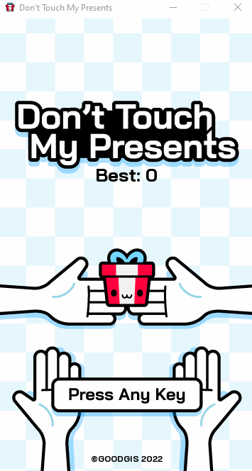

# Don't Touch My Presents - PiLang
<p align="center" >
    
</p>

Defend the present from incoming hands for as long as possible. This is a PiLang port of the original game, with corrected hand movement, score-based background-colour changes, and mouse movement as a control option.

## Play

### Packaged game

Open `Don't Touch My Presents.exe` to play the included Windows build.

### From source

Open PowerShell in this game folder and use the included PiLang runtime from the parent directory:

```powershell
..\pilang.exe run .\main.pi
```

Run the command from this folder so the game can find its images and audio files.

## Controls

- Start a round: left-click, `Space`, Left Arrow, Right Arrow, `A`, or `D`.
- Move the present: move the mouse, or use the arrow keys / `W`, `A`, `S`, `D`.

The background colour changes every 10 points. A collision ends the round and returns you to the menu.

## Rebuild

To rebuild the compiled PiLang project file only:

```powershell
..\pilang.exe build .\main.pi
```

To rebuild the Windows executable described by `package.loon`:

```powershell
..\pilang.exe pack target:win
```

To rebuild the Browser support described by `package.loon`:

```powershell
..\pilang.exe pack target:web
```

The packaging command recreates `main.px` and replaces `Don't Touch My Presents.exe`. Make a copy first if you need to preserve the existing executable.

## Project layout

- `main.pi` creates the window and drives the frame loop.
- `game_phases.pi` manages menus, gameplay, scoring, and collisions.
- `global_state.pi` stores the current game state and high score.
- `config.pi` contains game dimensions, movement settings, and asset paths.
- `components/player.pi` handles keyboard and mouse movement.
- `components/hand.pi` handles enemy movement and collisions.
- `components/scoreboard.pi` records the best score.
- `services/visualization.pi` renders the backgrounds and sprites.
- `services/music.pi` loads and plays music and sound effects.

## Credits

The original **Don't Touch My Presents** game was created by [Goodgis (`Gooodgis`)](https://github.com/Gooodgis/dont-touch-my-presents) in Python and Pygame. This project ports the game to PiLang, fixes the hand-movement and background-colour behaviour, and adds mouse movement as a valid control option. The original game's authorship remains with its creator.

The original project is available under the [MIT License](https://github.com/Gooodgis/dont-touch-my-presents/blob/main/LICENSE).
