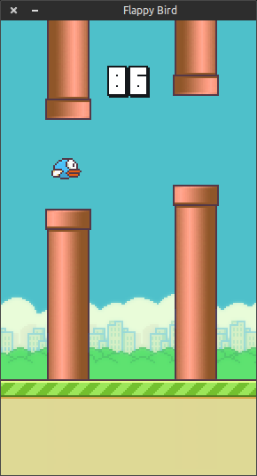

# Flappy Bird

A PiLang implementation of the familiar one-button arcade game. Guide the bird through an endless series of pipes and try to set a new high score.



## Play

On Windows, open `Flappy Bird.exe`.

Alternatively, run the source from this folder with the PiLang runtime located in the parent directory:

```powershell
..\pilang.exe run .\main.pi
```

Run the command while your current directory is `Flappy Bird`; the game loads its sprite and sound files using relative paths.

## Controls

- Start, flap, or restart after a game over: left-click, `Space`, or `Up Arrow`

Each flap sends the bird upward. Avoid the pipes and ground; passing a pipe earns one point.

## Build

To rebuild the Windows executable from the project manifest:

```powershell
..\pilang.exe pack target:win
```

This updates `main.px` and replaces `Flappy Bird.exe`. To compile only the PiLang project file, use:

```powershell
..\pilang.exe build .\main.pi
```

## Project layout

| Path | Purpose |
| --- | --- |
| `main.pi` | Game source code |
| `sprites/` | Backgrounds, bird frames, pipes, score digits, and interface art |
| `audio/` | Flap, score, collision, and game-over sounds |
| `package.loon` | Windows packaging configuration |

## License

The included game assets are provided under the [MIT License](LICENSE).
