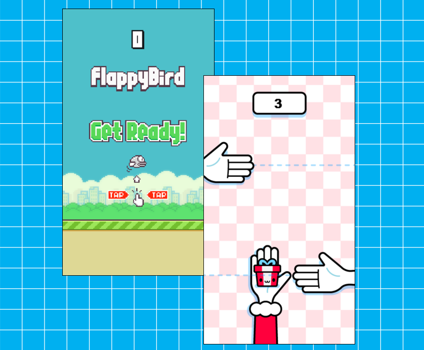

# PiLang Games

<p align="center">  
      
</p>

A small collection of games written in [PiLang](https://github.com/rolandbrake/pilang). The included `pilang.exe` is the PiLang runtime used to run and package the source projects on Windows.

## Trying

you can try the availble deployed games using only your borwser using these links:
<br/>
[Flappy Bird](https://flappybird-rolandbrake.wasmer.app/)
<br/>
[Don't touch my presents](https://donttouchmypresents-rolandbrake.wasmer.app/)

## Games

| Game | Play it | Source folder |
| --- | --- | --- |
| Don't Touch My Presents | Open `Don't Touch My Presents.exe` | `Don't Touch My Presents` |
| Flappy Bird | Open `Flappy Bird.exe` | `Flappy Bird` |

## Play from source

Open PowerShell in this directory, then start a game with the included runtime:

```powershell
Set-Location ".\Don't Touch My Presents"
..\pilang.exe run .\main.pi
```

```powershell
Set-Location ".\Flappy Bird"
..\pilang.exe run .\main.pi
```

Run each command from its game folder so its images, audio, and other relative asset paths load correctly.

### Controls

**Don't Touch My Presents**

- Start a round: left-click, `Space`, an arrow key, or `W`, `A`, `S`, or `D`.
- Move the gift: move the mouse, or use the arrow keys / `W`, `A`, `S`, `D`.
- Restart: `R`.

Keep the hands away from the present for as long as possible.

**Flappy Bird**

- Start or flap: left-click, `Space`, or Up Arrow.
- After game over: press one of those controls to start a new round.

## Rebuild the games

Each game has a `package.loon` manifest. From the game's own folder, run `pack` with the included runtime for windows executable or for browser support:

```powershell
Set-Location ".\Don't Touch My Presents"
..\pilang.exe pack target:win
..\pilang.exe pack target:web
```

```powershell
Set-Location ".\Flappy Bird"
..\pilang.exe pack target:win
..\pilang.exe pack target:web
```

This rebuilds `main.px` and creates the `.exe` named by that game's `package.loon`. It replaces the existing game executable, so make a copy first if you need to keep it.

To build only the compiled PiLang project file without packaging an executable, run:

```powershell
..\pilang.exe build .\main.pi
```

## Credits

### Don't Touch My Presents

The original **Don't Touch My Presents** game was created by [Goodgis (`Gooodgis`)](https://github.com/Gooodgis/dont-touch-my-presents) in Python and Pygame. This version is a PiLang port: it converts the game to PiLang, fixes the hand-movement and background-colour issues, and adds mouse movement as a valid control option. The original game's authorship belongs to its creator; this port does not claim it.

The original project is available under the [MIT License](https://github.com/Gooodgis/dont-touch-my-presents/blob/main/LICENSE).
